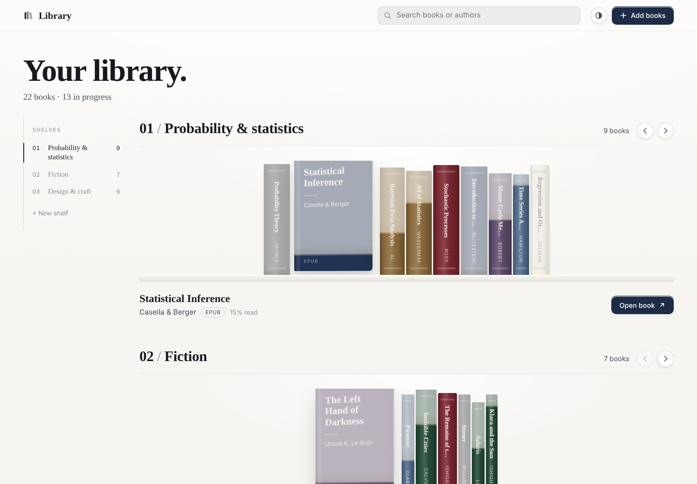

# Library

A personal library web app: a home for my books with themed shelves, custom animations and synced reading, with the files stored on my home lab.



## What works today

- Upload EPUB, PDF, CBZ, MOBI/AZW3, FB2, TXT and Markdown (button or drag and drop). Duplicates are detected.
- Title, author and cover pulled from EPUB, CBZ (ComicInfo.xml) and simple PDFs. Books without a cover get a generated one.
- Themed shelves stacked vertically, with a gallery-style index down the side.
- Reading progress lights each book from the bottom up; finished books are at full brightness.
- Porcelain design in light and dark mode.
- Storage on a folder (local disk or NAS mount) or any S3-compatible server.
- Import books already in the storage folder: `POST /api/library/scan`.

The in-app reader, login, sync and offline mode are next. See the [v1 milestone](https://github.com/OccupiedPorcupine/library/milestone/1).

## Run it locally

```sh
npm install
npm run seed --workspace server   # optional: demo shelves
npm run dev                       # server on :8080, web on :5173
```

Open http://localhost:5173.

## Deploy

See [docs/deploy.md](docs/deploy.md): Docker Compose on a Proxmox VM, exposed on the tailnet with `tailscale serve`.

## Layout

| Path | What |
| --- | --- |
| `server/` | Fastify API, SQLite (`better-sqlite3`), storage drivers, format detection and metadata |
| `web/` | React + Vite app. Design tokens in `web/src/styles/tokens.css` |
| `docs/` | Concept art, performance budget, deploy guide |

## Docs

- [Performance budget](docs/performance.md)
- [Concept art](docs/concepts/)
