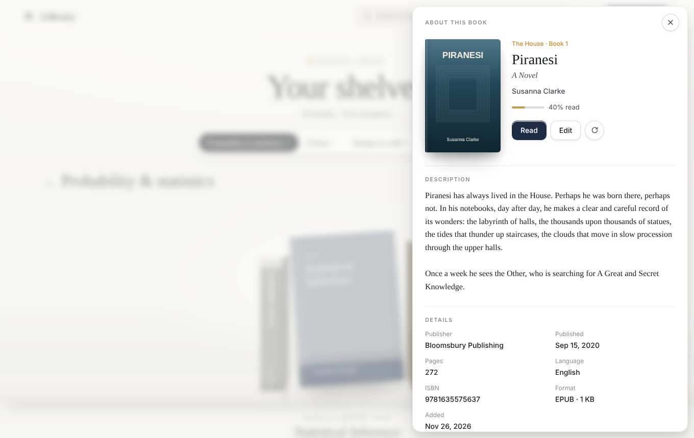

# Library

A personal library web app: a home for my books with themed shelves, custom animations and synced reading, with the files stored on my home lab.




## What works today

- Upload EPUB, PDF, CBZ, MOBI/AZW3, FB2, TXT and Markdown (button or drag and drop). Duplicates are detected.
- Metadata is gathered automatically, in this order:
  0. Junk such as download-site watermarks, URLs and tool names in the file's metadata is ignored.
  1. **The file:** EPUB package data and table of contents (nav or NCX), PDF info/XMP, bookmarks and an ISBN found on the first pages (page 1 is rendered as the cover), CBZ ComicInfo.xml.
  1b. **AI (optional):** with `OPENAI_API_KEY` in `.env`, an AI reads the file name, embedded metadata and opening pages and returns a clean title, subtitle, authors, series, year and language (an ISBN only if it is printed in the text). Runs before the online lookups so they search with the cleaned details.
  2. **Open Library** (free, no key), by ISBN, else by title and author.
  3. **Google Books** (free; optional `GOOGLE_BOOKS_API_KEY` in `.env`) for whatever is still missing.
  4. **You:** edit any field or upload a cover. Edited fields are never overwritten by later lookups.

  Fields: title, subtitle, author(s), series and number, cover, description, publisher, publication date, page count, language, ISBN-10/13, subjects and table of contents. Lookups run in a background queue after upload (and once for books added before this existed); set `METADATA_ONLINE=false` to stay offline.
- Click the book facing you (or **Details**) for a preview page: cover, details, description, subjects and the table of contents. Click the cover, **Read**, or any contents entry to open the book right there.
- A minimal in-app reader: foliate-js for EPUB, MOBI/AZW3, FB2 and CBZ; pdf.js for PDF (pages render as you scroll, soft dark mode). Remembers where you were on each device and saves reading progress.
- Spines take their colour from the cover.
- **AI shelving (optional):** new books that land on no shelf are placed on a matching shelf; **Sort with AI** does the same for all unshelved books. When books share a theme no shelf covers, a suggested shelf appears as a card you can rename, add or dismiss. Nothing new is created without you.
- Themed shelves stacked vertically. Books stand as 3D boxes; the one in focus swings round to show its cover. Drag, swipe, scroll sideways, click a spine or use the arrow keys to browse. A sticky pill of shelf names jumps between shelves.
- Reading progress lights each book from the bottom up; finished books are at full brightness. This dimming can be turned off in display settings (saved per device).
- Porcelain design in light and dark mode.
- Storage on a folder (local disk or NAS mount) or any S3-compatible server.
- Import books already in the storage folder: `POST /api/library/scan`.

The in-app reader, login, sync and offline mode are next. See the [v1 milestone](https://github.com/OccupiedPorcupine/library/milestone/1).

## Run it locally

```sh
npm install
npm run seed --workspace server   # optional: demo shelves
npm run dev                       # server on :8080, web on :5173
```

Open http://localhost:5173.

## Deploy

See [docs/deploy.md](docs/deploy.md): Docker Compose on a Proxmox VM, exposed on the tailnet with `tailscale serve`.

## Layout

| Path | What |
| --- | --- |
| `server/` | Fastify API, SQLite (`better-sqlite3`), storage drivers, format detection and metadata |
| `web/` | React + Vite app. Design tokens in `web/src/styles/tokens.css` |
| `docs/` | Concept art, performance budget, deploy guide |

## Docs

- [Performance budget](docs/performance.md)
- [Concept art](docs/concepts/)
